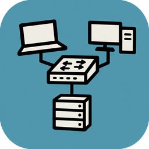
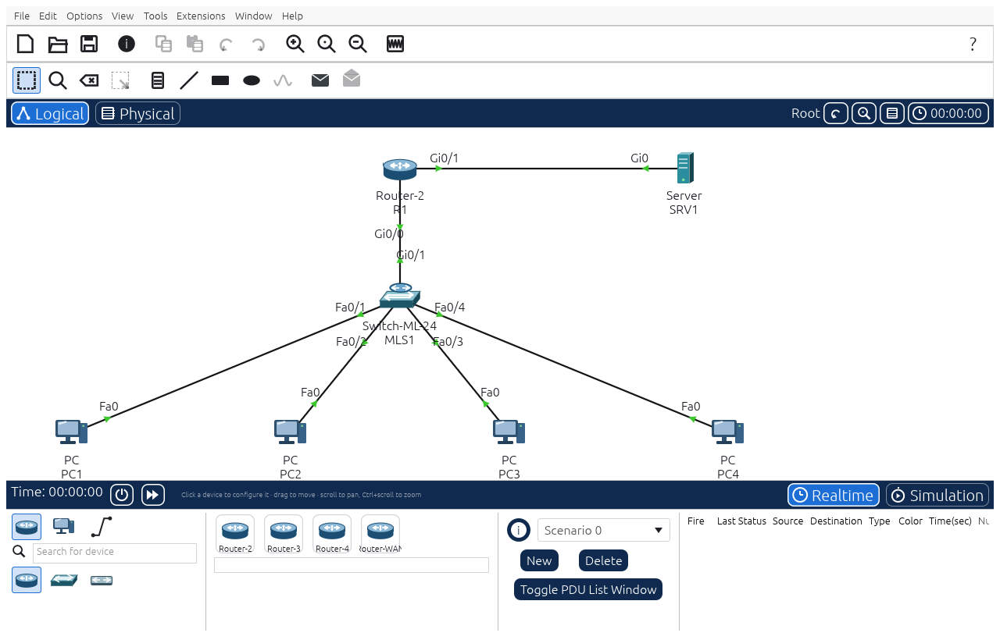
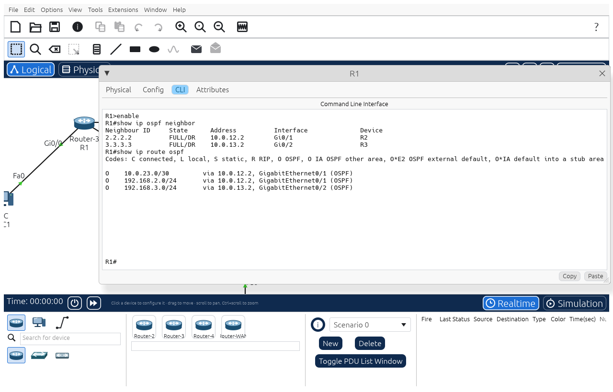
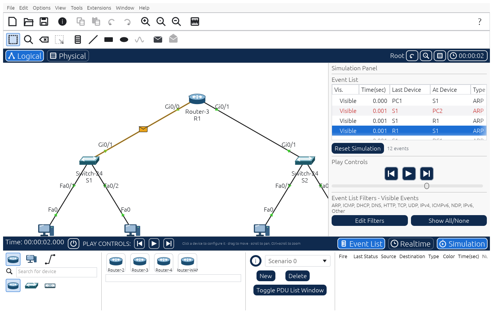
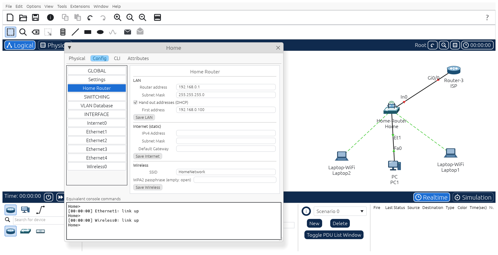
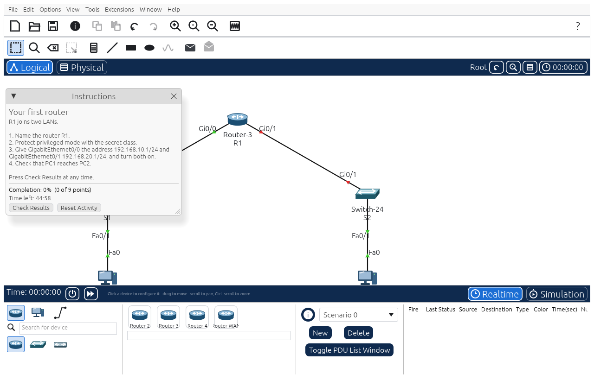
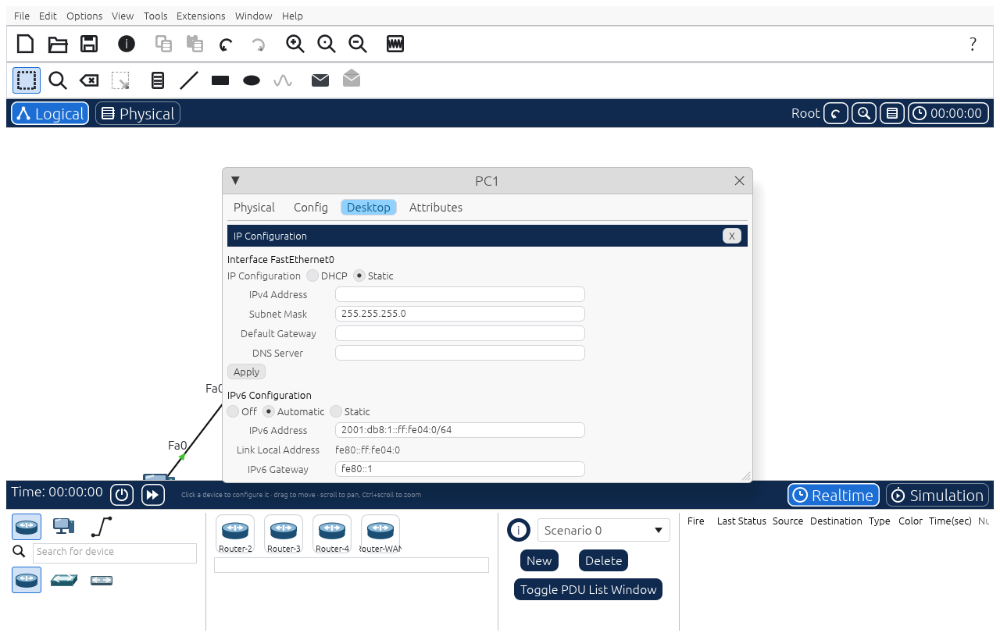
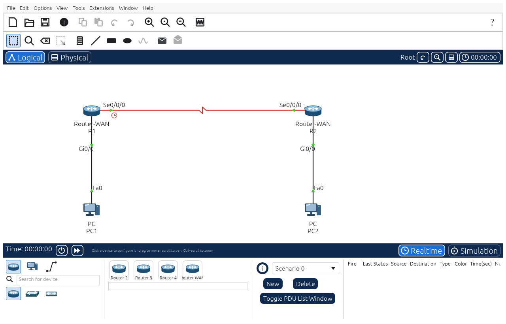

<p align="center">
  
</p>

<h1 align="center">NetLabCraft</h1>

<p align="center">
  <b>Network labs for learning and teaching; an open-source, clean-room network simulator built in pure Rust.</b>
</p>

<p align="center">
  Build a network, configure routers and switches by typing the commands you learn in class,
  and watch every frame cross it. It runs natively on Linux, Windows and macOS, and in the
  browser via WebAssembly.
</p>

<p align="center">
  
  
  
  
  
</p>

<br>

<p align="center">
  
  <br><sub><b>Inter-VLAN routing on a multilayer switch</b>: one of the thirty-one sample labs (<code>File → New → Sample</code>), built entirely from NetLabCraft commands.</sub>
</p>

<p align="center">
  <a href="#a-look-around">A look around</a> ·
  <a href="#why-netlabcraft">Why NetLabCraft</a> ·
  <a href="#what-it-simulates">What it simulates</a> ·
  <a href="#the-ccna-lab-book">Lab book</a> ·
  <a href="#quick-start">Quick start</a> ·
  <a href="#for-agents-mcp-and-cli">For agents</a> ·
  <a href="#architecture">Architecture</a> ·
  <a href="#roadmap">Roadmap</a> ·
  <a href="#downloads">Downloads</a> ·
  <a href="#license-and-credits">License and credits</a>
</p>

## A look around

<table>
<tr>
<td width="50%" valign="top"><p align="center"><sub><b>The console.</b> User, privileged and configuration modes, abbreviations, <code>?</code> help, Tab completion, history and debugs.</sub></p></td>
<td width="50%" valign="top"><p align="center"><sub><b>Simulation mode.</b> Every frame in an event list, replayed on the canvas, decoded layer by layer and exportable to pcap.</sub></p></td>
</tr>
<tr>
<td width="50%" valign="top"><p align="center"><sub><b>Wireless.</b> Home routers with DHCP, NAT and Wi-Fi out of the box, access points, Wi-Fi laptops with WPA2.</sub></p></td>
<td width="50%" valign="top"><p align="center"><sub><b>Activities.</b> Instructions, checks worth points, hints, a time limit and a password lock, built with the Activity Wizard.</sub></p></td>
</tr>
<tr>
<td width="50%" valign="top"><p align="center"><sub><b>PC desktop.</b> IP Configuration with DHCP, static and IPv6 autoconfiguration; Command Prompt and Web Browser.</sub></p></td>
<td width="50%" valign="top"><p align="center"><sub><b>Serial WAN links.</b> DCE and DTE ends, clock rate, HDLC or PPP with PAP and CHAP; the clock marks the DCE end.</sub></p></td>
</tr>
</table>

## Why NetLabCraft

- **Familiar.** The window is arranged like the network simulator learners already know: menus and
  toolbars, the device box, Realtime and Simulation modes, device windows with Physical, Config,
  CLI, Desktop and Services tabs. Every picture and message is our own work.
- **Real frames.** Devices exchange encoded Ethernet, 802.11, ARP, IPv4, IPv6, ICMP, NDP, TCP, UDP,
  DHCP, DHCPv6, DNS, HTTP, TLS 1.2, SSH 2.0, RESTCONF, NETCONF, FTP, SMTP, POP3, NTP, syslog,
  TFTP, SNMP, RADIUS with EAP, PEAP, CAPWAP, TACACS+, SIP, STP and RSTP, OSPF, RIP, RIPng, EIGRP,
  HSRP, VRRP, LLDP, LACP, GRE, IKEv1, IKEv2 and ESP frames, IPv4 fragments included; their
  Diffie-Hellman exchanges and AES encryption are computed for real. Captures open in any
  packet analyser, and a dropped frame says why.
- **Open.** Labs are readable JSON ([`.nlcraft`](docs/file-format.md)); the code is MIT or Apache-2.0.
- **Agent-native.** Every action is a command that agents can run through an **MCP server** or the
  CLI, including typing at any device's console.
- **In your language.** The interface comes in English, Spanish, Brazilian Portuguese, French, Italian,
  German and Simplified Chinese (Options → Language), the system's language by default; the consoles stay in English, as on real equipment. Adding a
  language is adding a text file: [docs/translating.md](docs/translating.md).
- **Everywhere.** One Rust codebase for the desktop and the web. No account, no sign-in, no telemetry.
- **Never loses your work.** No panics in product code, every input treated as hostile, every
  command fuzzed, and a last-resort guard that restores the lab.

## What it simulates

- **Devices:** 53 models with our own names ([which one to place for a vendor model](docs/model-equivalents.md)):
  fixed and modular routers, a stateful firewall, access and multilayer switches (some with fiber
  or power over Ethernet), home routers and gateways, access points and a wireless controller, a
  provider cloud, hubs, PCs, laptops, tablets and phones (Wi-Fi or mobile data through cell
  towers), servers, a printer, IP phones, eighteen IoT things and two programmable boards.
- **Cables:** automatic, straight-through, cross-over, fiber, console, serial, coaxial, phone and
  IoT cables; a wrong one leaves the link down and says why. The physical view has cities,
  buildings and closets, with copper limits and Wi-Fi range by building.
- **Switching:** VLANs, trunks, DTP, spanning tree (including rapid-pvst and its guards),
  EtherChannel, VTP, port security, DHCP snooping, dynamic ARP inspection, CDP and LLDP, 802.1p
  CoS and power over Ethernet.
- **Routing:** static and floating routes, RIP, OSPF (several areas, stub, authentication),
  EIGRP, router-on-a-stick, multilayer switching, HSRP, VRRP v2 and v3, GLBP, HDLC and PPP.
- **IPv6:** addressing, neighbour discovery, SLAAC, DHCPv6, static routes, OSPFv3, EIGRP for IPv6,
  RIPng and ACLs.
- **Security:** ACLs, NAT and PAT, AAA with RADIUS and TACACS+, SSH, GRE, site-to-site IPsec
  (IKEv1 and IKEv2 with real Diffie-Hellman, AES, DES, 3DES, AH and HMACs), zone-based and
  stateful firewalls, certificates (RSA, X.509) in TLS and SSH, and path MTU discovery.
- **Services and automation:** HTTP, DNS, DHCP, email, FTP, TFTP, NTP, syslog, SNMP v2c and v3;
  RESTCONF and NETCONF on routers; a Programming app and a controller mode on PCs.
- **Wireless, voice and IoT:** WPA2-PSK and WPA2-Enterprise (PEAP), controller with lightweight
  APs, roaming, real 802.11 frames; IP phones that register and call each other (SIP or the
  router's own signalling); smart things, home gateway rules and boards running BoardScript.
- **Simulation mode:** an event list replayed on the canvas, simple and complex PDUs, OSI layer
  details, scenarios, capture filters, drop reasons and pcap export.
- **Console and PC prompt:** every mode a CCNA course uses, with `?` help, Tab completion and
  output filters (1065 grammar entries in all; see
  [`docs/command-reference.md`](docs/command-reference.md)); on PCs `ipconfig`, `ping`,
  `tracert`, `nslookup`, `telnet`, `ssh`, `ftp`, `netstat` and more.
- **Activities:** checks worth points, sections, hints, values per student, time limits, password
  locks, an Activity Wizard, and instructor tools (answer network, assessment tree, signed
  results).

The full protocol-by-protocol list is in [`docs/protocol-parity.md`](docs/protocol-parity.md).
What it doesn't do yet is listed, ranked, in [`docs/gaps.md`](docs/gaps.md).

## The CCNA lab book

[`docs/labs/`](docs/labs/README.md) holds thirty-one hands-on labs written for NetLabCraft over the
topics of the three CCNA courses (four for the first, fourteen for the second and thirteen for
the third), plus one on mobile data. Nine of them are troubleshooting labs where you find and
fix deliberate faults (VLANs and trunks, routing, OSPF, ACLs, DHCP, NAT, spanning tree), and two
teach you to read the OSPF database and spanning-tree views. Each lab lists its topology, addressing, every command to
type and what to check. Every lab is also a test: the suite runs each one end to end as
written, and eight of them through the MCP server, so a lab that passes there works when typed
by hand.

## Quick start

```sh
cargo run --release -p netlabcraft                            # desktop app
cargo run --release -p netlabcraft -- --sample vlans          # open a sample lab
cargo run --release -p netlabcraft -- lab.nlcraft              # open a lab
cargo run --release -p netlabcraft-cli -- samples             # list the sample labs
cargo xtask ci                                                # fmt, clippy, tests, assets, layering, wasm, parity
```

Click a device to open its window; drag to move it; scroll to pan and Ctrl+scroll to zoom.
Choose your language under Options → Language.

### Install on Linux (your user only)

```sh
packaging/linux/install.sh            # builds, then installs to ~/.local: menu entry, icon, .nlcraft files
packaging/linux/install.sh --remove   # uninstalls
```

### Web

```sh
cd apps/netlabcraft-web && trunk build --release     # → dist/web (serve it with any static server)
cd apps/netlabcraft-web && trunk serve --release     # http://127.0.0.1:8781  (?sample=vlans opens a sample)
```

You need [trunk](https://trunk-rs.github.io/trunk/) and the `wasm32-unknown-unknown` target. Open
uses the browser's file picker and Save downloads the lab; the browser asks before a tab with
unsaved changes closes.

## For agents: MCP and CLI

```sh
claude mcp add netlabcraft -- netlabcraft-cli mcp                       # headless MCP server
netlabcraft-cli exec --sample two-subnets R1 enable 'show ip route'     # type at a console
netlabcraft-cli run --sample lan --cmd 'net.ping={"from":"PC1","to":"192.168.1.13"}'
netlabcraft-cli pcap --sample vlans --ping PC1:192.168.20.10 --out vlans.pcap
netlabcraft-cli commands                                                 # every command and its params
```

The MCP server offers `netlabcraft_run` (any engine command), `netlabcraft_cli` (type lines at a
device), `netlabcraft_lab` (devices, ports, addresses and cables) and `netlabcraft_commands`. See
[`docs/mcp.md`](docs/mcp.md) and [`docs/cli.md`](docs/cli.md).

## Architecture

NetLabCraft is an engine-first Cargo workspace with enforced layering (`cargo xtask layers`). The
egui frontend is a separate crate, so the UI can be swapped without touching the simulator.

| Layer | Crates |
|---|---|
| L0 | `core` (MAC and IP addresses, networks, VLAN ids) |
| L1 | `wire` (frame formats, checksums, pcap) |
| L2 | `model` (the lab: devices, ports, configuration, cables; the `.nlcraft` format) |
| L3 | `sim` (discrete-event simulator: switching, switch security, routing, STP, OSPF, RIP, RIPng, EIGRP, HSRP, VRRP, GLBP, IPv6, VPN with IKEv1 and IKEv2, QoS, firewalls, MTU, wireless with PEAP and central switching, voice and SIP, IoT, boards and BoardScript, PoE, automation over TLS and SSH, services, complex PDUs, Simulation-mode options) |
| L4 | `ios` (device consoles: grammar, configuration, `show` output, host shell) |
| L5 | `engine` (session, command catalog, undo, sample labs, activities and instructor tools, RESTCONF, NETCONF and the controller, boards) |
| L6 | `ui-egui` (the interface and its translations) · `mcp` (MCP server) |
| L7 | `apps/netlabcraft`, `apps/netlabcraft-cli`, `apps/netlabcraft-web` |

- **Contributor and agent rules** (clean room, asset policy, never-crash, quality gates): [`AGENTS.md`](AGENTS.md); how to contribute: [`CONTRIBUTING.md`](CONTRIBUTING.md); security reports: [`SECURITY.md`](SECURITY.md)
- **How it is built:** [`docs/architecture.md`](docs/architecture.md); decisions in [`docs/decisions.md`](docs/decisions.md)
- **Bundled assets:** each one is listed with its licence in [`ATTRIBUTION.md`](ATTRIBUTION.md)
- **Releases:** installers for Linux, Windows, macOS and the browser on the [Releases page](https://github.com/ayozetr/netlabcraft/releases) (not code-signed yet); how they are built: [`docs/releasing.md`](docs/releasing.md)

## Roadmap

NetLabCraft is **pre-alpha**: every core workflow works end to end (build a lab, configure it by
typing, ping, watch the frames, grade an activity, save), the [CCNA lab book](docs/labs/README.md)
runs as written, and every alpha and beta gate is met. Weighted by what CCNA labs rely on, we
estimated it at about 92% ready for real work: about 93% for the first CCNA course, 94% for the
second and 91% for the third (re-scored on 2026-11-13 after the 0.2.0 work; the
method is in [`docs/target-app-parity.md`](docs/target-app-parity.md#audiences)). Next up: more
labs walked to find console gaps, the last crypto and certificate details (IKE signatures, PEAP,
a transform set with no cipher), TVs, a sniffer and more router models, device windows as native
windows, and more interface languages. Stage, numbers and estimates are in
[ROADMAP.md](ROADMAP.md); the ranked work list is [`docs/gaps.md`](docs/gaps.md).

## Downloads

Installers for Linux (AppImage, `.deb`, `.rpm`, `.tar.gz`; x86_64 and aarch64), Windows (`.msi` and
a portable zip), macOS (a universal `.dmg`) and the browser (a static site) are on the
[Releases page](https://github.com/ayozetr/netlabcraft/releases), with a `SHA256SUMS.txt` to check
them against. They are **not code-signed yet**, so Windows and macOS warn you the first time you
run them; each release's notes say what to click. You can also build from source with the
[Quick start](#quick-start), or install for your user on Linux with `packaging/linux/install.sh`.
How releases are built is in [`docs/releasing.md`](docs/releasing.md).

## Clean room

NetLabCraft is built from public standards (IEEE, IETF RFCs) and black-box observation of how
network simulators behave. Nobody working on it reads, disassembles or decompiles any vendor's
software or file formats, and no vendor artwork, icons, sample labs or wording is used. Protocols
whose formats aren't public (CDP, DTP, PAgP) are simulated without their frames. For the same
reason it does not open `.pkt` files; see [`docs/decisions.md`](docs/decisions.md).

## License and credits

NetLabCraft is dual-licensed under [MIT](LICENSE-MIT) or [Apache-2.0](LICENSE-APACHE), at your
option. Copyright (c) 2026 the NetLabCraft contributors. Required notices are in [NOTICE](NOTICE).

Bundled icons, images and other assets keep their own open licences; each one is listed with its
author, source and licence in [ATTRIBUTION.md](ATTRIBUTION.md).

The app icon ([`assets/app-icon/`](assets/app-icon/)) was supplied by the project owner. Every
other icon and device picture is drawn in code and is original; the sample labs and every
screenshot in this README were made with NetLabCraft itself. NetLabCraft bundles no fonts beyond
the ones its UI toolkit ships with. Contributors: [`docs/contributors.md`](docs/contributors.md).

Cisco, Cisco IOS and Packet Tracer are trademarks of Cisco Systems, Inc. NetLabCraft is an
independent project, not affiliated with or endorsed by Cisco.
