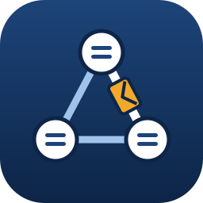

<p align="center">
  
</p>

<h1 align="center">PacketCraft</h1>

<p align="center">
  <b>Network labs for learning and teaching; an open-source, clean-room network simulator built in pure Rust.</b>
</p>

<p align="center">
  Build a network, configure routers and switches by typing the commands you learn in class,
  and watch every frame cross it. It runs natively on Linux, Windows, macOS and BSD, and in the
  browser via WebAssembly.
</p>

<p align="center">
  
  
  
  
  
</p>

<br>

<p align="center">
  
  <br><sub><b>Inter-VLAN routing on a multilayer switch</b>: one of the eighteen sample labs (<code>File → New → Sample</code>), built entirely from PacketCraft commands.</sub>
</p>

<p align="center">
  <a href="#a-look-around">A look around</a> ·
  <a href="#why-packetcraft">Why PacketCraft</a> ·
  <a href="#what-it-simulates">What it simulates</a> ·
  <a href="#quick-start">Quick start</a> ·
  <a href="#for-agents-mcp-and-cli">For agents</a> ·
  <a href="#architecture">Architecture</a> ·
  <a href="#roadmap">Roadmap</a> ·
  <a href="#downloads">Downloads</a> ·
  <a href="#license-and-credits">License and credits</a>
</p>

## A look around

<table>
<tr>
<td width="50%" valign="top"><p align="center"><sub><b>The console.</b> User, privileged and configuration modes, abbreviations, <code>?</code> help, Tab completion, history and debugs.</sub></p></td>
<td width="50%" valign="top"><p align="center"><sub><b>Simulation mode.</b> Every frame in an event list, replayed on the canvas, decoded layer by layer and exportable to pcap.</sub></p></td>
</tr>
<tr>
<td width="50%" valign="top"><p align="center"><sub><b>Wireless.</b> Home routers with DHCP, NAT and Wi-Fi out of the box, access points, Wi-Fi laptops with WPA2.</sub></p></td>
<td width="50%" valign="top"><p align="center"><sub><b>Activities.</b> Instructions, checks worth points, hints, a time limit and a password lock, built with the Activity Wizard.</sub></p></td>
</tr>
<tr>
<td width="50%" valign="top"><p align="center"><sub><b>PC desktop.</b> IP Configuration with DHCP, static and IPv6 autoconfiguration; Command Prompt and Web Browser.</sub></p></td>
<td width="50%" valign="top"><p align="center"><sub><b>Serial WAN links.</b> DCE and DTE ends, clock rate, HDLC or PPP with PAP and CHAP; the clock marks the DCE end.</sub></p></td>
</tr>
</table>

## Why PacketCraft

- **Familiar.** The window is arranged like the network simulator learners already know: menus and
  toolbars, the device box, Realtime and Simulation modes, device windows with Physical, Config,
  CLI, Desktop and Services tabs. Every picture and message is our own work.
- **Real frames.** Devices exchange encoded Ethernet, ARP, IPv4, IPv6, ICMP, NDP, TCP, UDP, DHCP,
  DNS, HTTP, FTP, RADIUS, STP, OSPF, RIP, HSRP, LLDP and LACP frames. Captures open in any packet
  analyser, and a dropped frame says why.
- **Open.** Labs are readable JSON ([`.pcraft`](docs/file-format.md)); the code is MIT or Apache-2.0.
- **Agent-native.** Every action is a command that agents can run through an **MCP server** or the
  CLI, including typing at any device's console.
- **In your language.** The interface comes in English and Spanish (Options → Language), the
  system's language by default; the consoles stay in English, as on real equipment.
- **Everywhere.** One Rust codebase for the desktop and the web. No account, no sign-in, no telemetry.
- **Never loses your work.** No panics in product code, every input treated as hostile, every
  command fuzzed, and a last-resort guard that restores the lab.

## What it simulates

- **Devices:** routers (also one with serial WAN ports), switches (also a multilayer one that
  routes), a home wireless router, a Wi-Fi access point, a hub, PCs, laptops (also with Wi-Fi),
  servers, a printer, a wireless LAN controller and lightweight APs: 18 models with our own
  names; [docs/model-equivalents.md](docs/model-equivalents.md) says which one to place when a
  course lab names a vendor model.
- **Switching:** MAC learning, VLANs, access and 802.1Q trunk ports, DTP, per-VLAN spanning tree
  with its timers and rapid-pvst, EtherChannel (LACP, PAgP, static), VTP, port security, switch
  VLAN interfaces, CDP and LLDP.
- **Routing:** static routes, RIP, OSPF (several areas, DR/BDR, stub areas, ranges) and OSPFv3,
  router-on-a-stick, multilayer switching, HSRP, ACLs, NAT and PAT, DHCP server and relay; serial
  links with HDLC or PPP (PAP, CHAP).
- **IPv6:** global, EUI-64 and link-local addresses on ports, subinterfaces and VLAN interfaces,
  neighbour discovery, router advertisements, SLAAC, DHCPv6 (stateless, stateful, relay), static
  routes, OSPFv3, IPv6 ACLs.
- **Services:** servers with HTTP (and a web browser on the PCs), DNS, DHCP, NTP, syslog, TFTP,
  FTP and AAA (RADIUS); Telnet and SSH between devices, logins checked against local users or a
  RADIUS server.
- **Console:** every mode a CCNA course uses, `?` help, Tab completion, `do`, `interface range`,
  `running-config` / `startup-config` / `write` / `reload`, `copy` to and from TFTP and FTP, debugs,
  and 351 command forms ([`docs/command-reference.md`](docs/command-reference.md)).
- **PC Command Prompt:** `ipconfig` (static or DHCP), `ipv6config` (static or automatic), `ping`,
  `tracert`, `nslookup`, `telnet`, `ssh`, `ftp`, `dir`, `arp`.
- **Activities:** a lab can carry instructions and checks worth points (configuration lines,
  pings, addresses, command output), with hints, a time limit, a password lock, Check Results,
  Reset Activity and an Activity Wizard that captures the answers from a finished lab.

What it doesn't do yet is listed, ranked, in [`docs/gaps.md`](docs/gaps.md).

## Quick start

```sh
cargo run --release -p packetcraft                            # desktop app
cargo run --release -p packetcraft -- --sample vlans          # open a sample lab
cargo run --release -p packetcraft -- lab.pcraft              # open a lab
cargo run --release -p packetcraft-cli -- samples             # list the sample labs
cargo xtask ci                                                # fmt, clippy, tests, assets, layering, wasm, parity
```

Click a device to open its window; drag to move it; scroll to pan and Ctrl+scroll to zoom.
Choose Español under Options → Language for the Spanish interface.

### Install on Linux (your user only)

```sh
packaging/linux/install.sh            # builds, then installs to ~/.local: menu entry, icon, .pcraft files
packaging/linux/install.sh --remove   # uninstalls
```

### Web

```sh
cd apps/packetcraft-web && trunk build --release     # → dist/web (serve it with any static server)
cd apps/packetcraft-web && trunk serve --release     # http://127.0.0.1:8781  (?sample=vlans opens a sample)
```

You need [trunk](https://trunk-rs.github.io/trunk/) and the `wasm32-unknown-unknown` target. Open
uses the browser's file picker and Save downloads the lab; the browser asks before a tab with
unsaved changes closes.

## For agents: MCP and CLI

```sh
claude mcp add packetcraft -- packetcraft-cli mcp                       # headless MCP server
packetcraft-cli exec --sample two-subnets R1 enable 'show ip route'     # type at a console
packetcraft-cli run --sample lan --cmd 'net.ping={"from":"PC1","to":"192.168.1.13"}'
packetcraft-cli pcap --sample vlans --ping PC1:192.168.20.10 --out vlans.pcap
packetcraft-cli commands                                                 # every command and its params
```

The MCP server offers `packetcraft_run` (any engine command), `packetcraft_cli` (type lines at a
device), `packetcraft_lab` (devices, ports, addresses and cables) and `packetcraft_commands`. See
[`docs/mcp.md`](docs/mcp.md) and [`docs/cli.md`](docs/cli.md).

## Architecture

PacketCraft is an engine-first Cargo workspace with enforced layering (`cargo xtask layers`). The
egui frontend is a separate crate, so the UI can be swapped without touching the simulator.

| Layer | Crates |
|---|---|
| L0 | `core` (MAC and IP addresses, networks, VLAN ids) |
| L1 | `wire` (frame formats, checksums, pcap) |
| L2 | `model` (the lab: devices, ports, configuration, cables; the `.pcraft` format) |
| L3 | `sim` (discrete-event simulator: switching, routing, STP, OSPF, RIP, HSRP, IPv6, services) |
| L4 | `ios` (device consoles: grammar, configuration, `show` output, host shell) |
| L5 | `engine` (session, command catalog, undo, sample labs, activities) |
| L6 | `ui-egui` (the interface and its translations) · `mcp` (MCP server) |
| L7 | `apps/packetcraft`, `apps/packetcraft-cli`, `apps/packetcraft-web` |

- **Contributor and agent rules** (clean room, asset policy, never-crash, quality gates): [`AGENTS.md`](AGENTS.md)
- **How it is built:** [`docs/architecture.md`](docs/architecture.md); decisions in [`docs/decisions.md`](docs/decisions.md)
- **Bundled assets:** each one is listed with its licence in [`ATTRIBUTION.md`](ATTRIBUTION.md)
- **Releases:** not yet; the plan is in [`docs/releasing.md`](docs/releasing.md)

## Roadmap

PacketCraft is **pre-alpha**: every core workflow works end to end (build a lab, configure it by
typing, ping, watch the frames, grade an activity, save), but there are no installers yet beyond
the Linux user install. Weighted by what CCNA labs rely on, we estimate it is about 68% ready for
real work: about 80% for the first CCNA course, 84% for the second and 70% for the third. Next up:
walking the CCNA 1 labs command by command, WLC and 802.11 frames, email and SNMP, and per-student
variables in activities. Stage, numbers and estimates are in [ROADMAP.md](ROADMAP.md); the ranked
work list is [`docs/gaps.md`](docs/gaps.md).

## Downloads

There is no release yet: build from source with the [Quick start](#quick-start), or install for
your user on Linux with `packaging/linux/install.sh`. How releases will work (versions, installers
for Linux, Windows, macOS, FreeBSD and the web, file names) is in
[`docs/releasing.md`](docs/releasing.md).

## Clean room

PacketCraft is built from public standards (IEEE, IETF RFCs) and black-box observation of how
network simulators behave. Nobody working on it reads, disassembles or decompiles any vendor's
software or file formats, and no vendor artwork, icons, sample labs or wording is used. Protocols
whose formats aren't public (CDP, DTP, PAgP) are simulated without their frames. For the same
reason it does not open `.pkt` files; see [`docs/decisions.md`](docs/decisions.md).

## License and credits

PacketCraft is dual-licensed under [MIT](LICENSE-MIT) or [Apache-2.0](LICENSE-APACHE), at your
option. Copyright (c) 2026 the PacketCraft contributors. Required notices are in [NOTICE](NOTICE).

Bundled icons, images and other assets keep their own open licences; each one is listed with its
author, source and licence in [ATTRIBUTION.md](ATTRIBUTION.md).

The app icon ([`assets/app-icon/`](assets/app-icon/)) was supplied by the project owner. Every
other icon and device picture is drawn in code and is original; the sample labs and every
screenshot in this README were made with PacketCraft itself. PacketCraft bundles no fonts beyond
the ones its UI toolkit ships with. Contributors: [`docs/contributors.md`](docs/contributors.md).

Cisco, Cisco IOS and Packet Tracer are trademarks of Cisco Systems, Inc. PacketCraft is an
independent project, not affiliated with or endorsed by Cisco.
